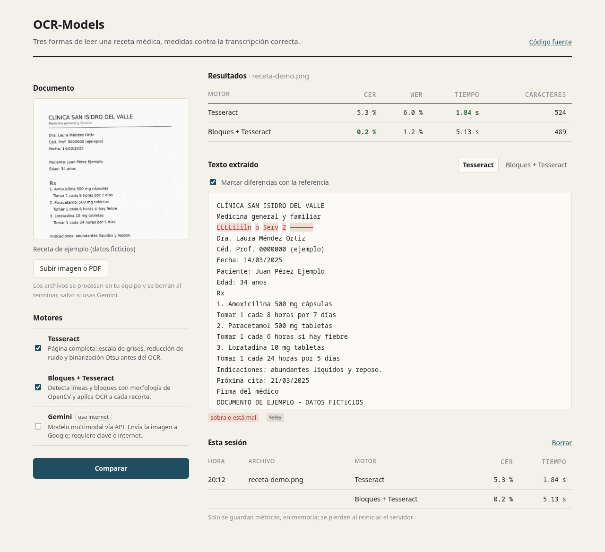

# OCR-Models

**Español** · [English](#english)

Compara tres formas de extraer texto de una receta médica y mide cuánto se equivoca cada una frente a la transcripción correcta.



| Motor | Cómo funciona | Red |
|---|---|---|
| **Tesseract** | Limpia la página con OpenCV (escala de grises, reducción de ruido, Otsu) y la lee completa. | No |
| **Bloques + Tesseract** | Detecta cada línea de texto con morfología de OpenCV y lee los recortes por separado, en orden de lectura. | No |
| **Gemini** | Envía la imagen a un modelo multimodal de Google y le pide una transcripción literal. | Sí |

## Resultados con la receta de ejemplo

`assets/samples/receta-demo.png` es una receta **ficticia** generada con `scripts/make_sample.py`, que también escribe su transcripción exacta (`receta-demo.txt`). Con ella se calculan:

- **CER** (*character error rate*): ediciones de carácter necesarias para llegar a la referencia, divididas entre su longitud.
- **WER** (*word error rate*): lo mismo, contando palabras.

```text
Motor                 Tiempo   Caracteres    CER    WER
Tesseract             2.44 s          524   5.3%   6.0%
Bloques + Tesseract   5.60 s          489   0.2%   1.2%
```

Tesseract sobre la página completa confunde la línea horizontal del encabezado con texto; al aislar primero las líneas, ese ruido desaparece a cambio de más tiempo de proceso. Los tiempos son de una laptop con CPU y varían entre equipos.

## Requisitos

- Python 3.10 o superior
- Tesseract con los idiomas español e inglés
- Node.js 20 o superior (solo para la interfaz web)
- Poppler (`pdftoppm`), opcional, para leer PDF

```bash
# Arch Linux
sudo pacman -S tesseract tesseract-data-spa tesseract-data-eng poppler
# Debian / Ubuntu
sudo apt install tesseract-ocr tesseract-ocr-spa tesseract-ocr-eng poppler-utils
# macOS
brew install tesseract tesseract-lang poppler
```

## Instalación

```bash
git clone https://github.com/martinezmarianotea-code/OCR-Models.git
cd OCR-Models
python -m venv .venv
source .venv/bin/activate          # Windows: .venv\Scripts\activate
pip install -r requirements.txt
```

Para usar Gemini, copia `.env.example` como `.env` y agrega tu clave de [Google AI Studio](https://aistudio.google.com/apikey). Los otros dos motores funcionan sin conexión.

## Uso

### Interfaz web

```bash
cd frontend && npm install && npm run build && cd ..
python -m src.api
```

Abre <http://127.0.0.1:8000>. La receta de ejemplo ya viene cargada; también puedes subir una imagen o PDF y pegar su transcripción para medir el error. Para desarrollar con recarga automática usa `./dev.sh` (Vite en el puerto 5173).

### Terminal

```bash
python -m src.main assets/samples/receta-demo.png
python -m src.main foto.jpg --engines tesseract layout gemini
python -m src.main receta.pdf --reference transcripcion.txt --save resultados/
```

Si junto a la imagen existe un `.txt` con el mismo nombre, se usa como referencia automáticamente.

### Pruebas

```bash
pip install -r requirements-dev.txt
pytest
```

## Privacidad

Las recetas reales contienen datos personales y de salud.

- Los archivos subidos se guardan en un directorio temporal y se borran al terminar.
- El historial de la interfaz guarda solo métricas, en memoria.
- El servidor escucha únicamente en `127.0.0.1`.
- **Gemini envía la imagen a Google.** No lo uses con documentos reales sin el consentimiento de las personas involucradas.

## Estructura

```text
src/
├── engines/          un módulo por motor + registro común
├── metrics.py        CER, WER y proporción de ruido
├── documents.py      validación de archivos y conversión de PDF
├── api/              API FastAPI (sirve también el frontend compilado)
└── main.py           comparación desde la terminal
frontend/             interfaz en React + Vite
scripts/make_sample.py
tests/
```

## Licencia

[MIT](LICENSE)

---

## English

OCR-Models compares three ways of extracting text from a medical prescription and measures how far each one is from the correct transcription.

| Engine | How it works | Network |
|---|---|---|
| **Tesseract** | Cleans the page with OpenCV (grayscale, denoising, Otsu) and reads it whole. | No |
| **Blocks + Tesseract** | Finds each text line with OpenCV morphology and reads the crops separately, in reading order. | No |
| **Gemini** | Sends the image to a Google multimodal model and asks for a literal transcription. | Yes |

The bundled sample (`assets/samples/receta-demo.png`) is a **fictional** prescription generated by `scripts/make_sample.py`, together with its exact transcription. On that sample, full-page Tesseract reaches 5.3 % CER and the block-based pipeline 0.2 % CER, at roughly twice the processing time.

### Quick start

```bash
pip install -r requirements.txt                 # plus Tesseract with spa/eng data
python -m src.main assets/samples/receta-demo.png

cd frontend && npm install && npm run build && cd ..
python -m src.api                               # http://127.0.0.1:8000
```

Add `GEMINI_API_KEY` to `.env` to enable the Gemini engine. Uploaded files are processed in a temporary directory and deleted afterwards; only metrics are kept in memory. Gemini sends the image to Google, so avoid using it with real patient documents.

Licensed under the [MIT License](LICENSE).
